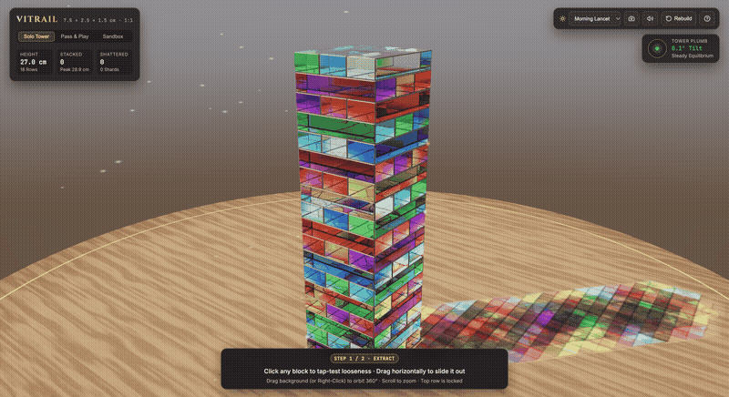
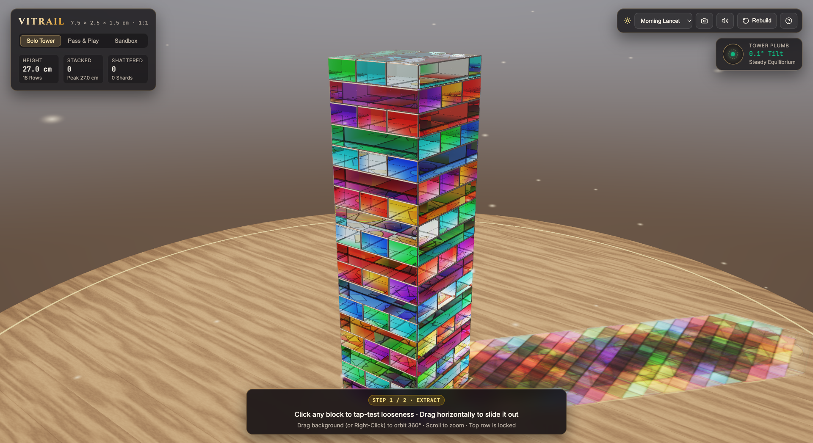
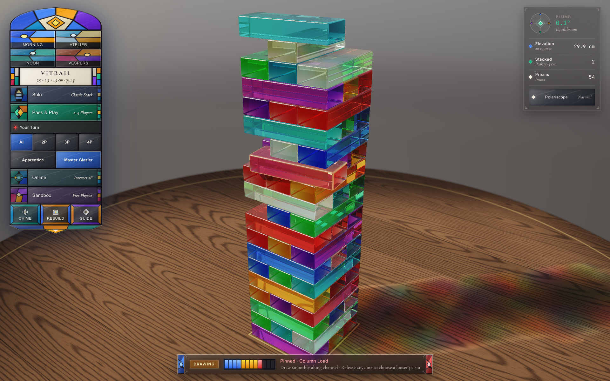
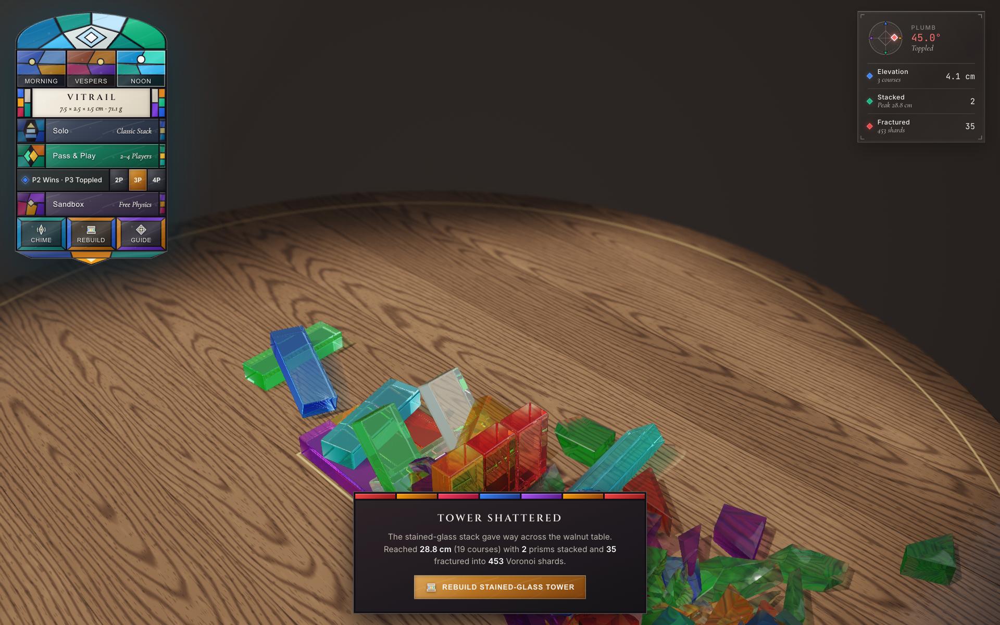

# Vitrail



Stained-glass Jenga built from scratch on WebGPU and Rapier3D. Every prism is modeled to 1:1 regulation scale (`7.5 × 2.5 × 1.5 cm`, `71.1 g` beveled cathedral soda-lime glass across 18 courses = `27.0 cm`) atop a quarter-sawn dark walnut stave pedestal table, raytraced through multi-block dielectric refraction with projected Snell caustics and 3D Voronoi glass shattering.

**[Play Live at vitrail.andrewvoirol.com →](https://vitrail.andrewvoirol.com)**

## Quick Start

Requires Node.js 20+ and a WebGPU browser (Chrome 113+, Edge 113+, or Safari 18+).

```bash
git clone https://github.com/andrewvoirol/tumbling-blocks-game.git
cd tumbling-blocks-game
npm install
npm run dev
```

## In Action

### 18-Row Equilibrium & Projected Stained-Glass Caustics


### Pass & Play Extraction & Top-Row Placement


### Cascade Collapse & 3D Voronoi Glass Fracture


## How It Works

1. **Scout loose glass by ear**: Click (`< 5 px`) any legal prism below the top completed course without locking in your turn. Each 3-prism course has physical micro-tolerance variance (~`0.09 mm` clearance on loose slots vs pinned load-bearing columns), so free glass rings at `2.3 kHz` while clamped glass ticks dryly at `3.8 kHz`.
2. **Draw smoothly along the channel**: Drag horizontally along a prism's length to slide it via a point-mass spring tether. Watch the 12-pane tension strip and **Plumb** spirit compass—if resistance spikes red and the tower leans, release before clearing the stack to pick a looser prism (`Escape` cancels an active pull).
3. **Free-hand stack on top**: Once extracted, position the prism anywhere across the top course with bevel-to-bevel side abutment. Angle with the scroll wheel or `Q` / `E`, turn `90°` with `R` (`0` aligns square), and click (or press `Space` / `Enter`) to release gently. Switch between **Solo**, **Pass & Play** (2–4 players), and **Sandbox** (unrestricted pulling + one-click Voronoi shatter) from the stained-glass lancet window, or drag the background / pinch to orbit and zoom.

Under the hood, a single-encoder WebGPU `rgba16float` HDR pipeline renders a `2048×2048` sun shadow map, a `1024×1024` spectral Beer-Lambert optical-depth & min-caster-height PCSS atlas, and a `2048×2048` vertex-refracted Snell waterglass caustic map onto the walnut table, then raytraces primary beveled prisms (`n = 1.522`) through up to two interior stained-glass blocks behind them with Abbe chromatic dispersion, total internal reflection, 3D seed bubbles, internal crazing spiderwebs, macro depth of field, and dual SDR / Apple Silicon XDR (`toneMapping: 'extended'`) output. Physics runs on `@dimforge/rapier3d-compat` (`^0.14.0`) with Froude-invariant (`Fr = 1`) scaling for `< 0.15 mm` 18-story stack compliance at `9.81 m/s²` gravity; high-velocity impacts clip blocks via 3D Sutherland-Hodgman half-spaces into volume-conserving convex Voronoi shards (`< 0.05%` error) paired with stereo-panned Web Audio modal synthesis.

## Tech Stack

| Layer | Technology |
| --- | --- |
| Rendering | Raw WebGPU + WGSL (`rgba16float` HDR, 4× MSAA, PCSS + Snell caustics, SDR / XDR extended tone mapping) |
| Physics & Fracture | `@dimforge/rapier3d-compat` (`^0.14.0`), 3D Sutherland-Hodgman Voronoi clipper (`512`-slot pool) |
| Audio | Procedural Web Audio API modal glass resonance, continuous slide friction & stereo-panned fracture synthesis |
| UI & Build | React 19, custom inlaid SVG stained-glass & crystal HUD, TypeScript 7, Vite 8, Vitest 5 |
